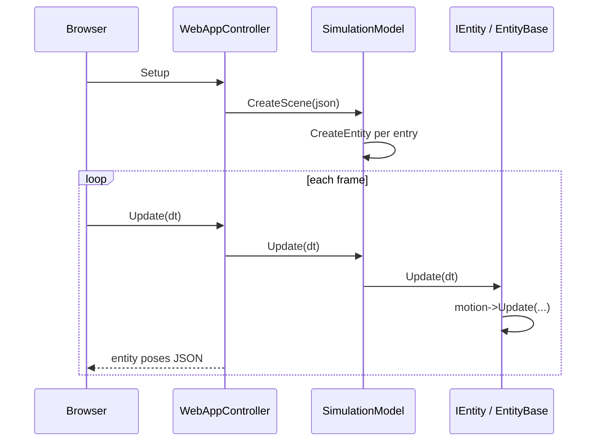
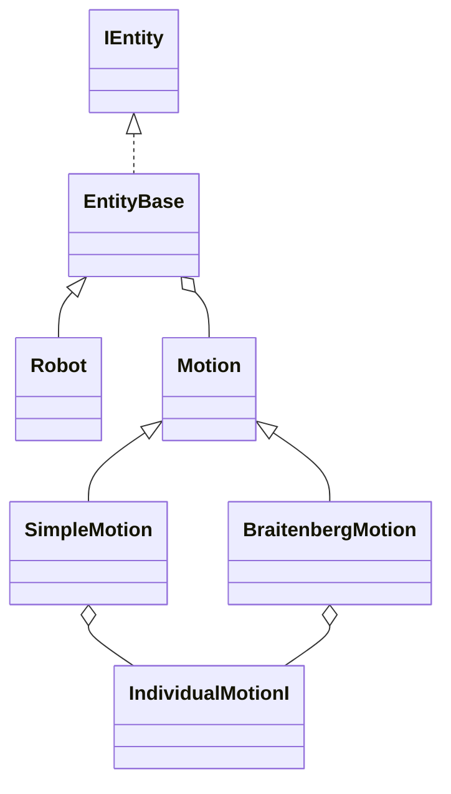

# CSCI 3081W — The Arena

## Overview

**The Arena** is a 2D robot simulation for CSCI 3081W. A C++ backend (`SimulationModel`, entities, motion strategies, sensors) loads a JSON scene, steps physics and behaviour, and streams state to a browser UI served by a small web app. The map and sprites are static assets under `apps/web-app/web/assets`.


**Developers (Team 001-8):** Chancelor K Louie-Badua, louie031, rothb066, turne509  

Course support code and tooling are attributed to course staff (see file headers).

---

## User documentation

### Prerequisites

- [Git](https://git-scm.com/)
- Docker or a Linux build environment with dependencies similar to the [Dockerfile](Dockerfile) (g++, make, clang-format, doxygen, optional Node.js for `make docs`)

### Run with Docker (development image)

The `env/Dockerfile` image mounts your repo: you build and run on the host path inside the container.

1. Build the image: `./bin/build-env.sh`
2. Run the container (default web port **8081**): `./bin/run-env.sh`  
   - Custom port: `./bin/run-env.sh 8082`
3. Inside the container: `make` then `make run`
4. Open **http://127.0.0.1:8081/** (or the port you chose).

### Production image (Docker Hub)

The repository root [Dockerfile](Dockerfile) produces a **deployment** image: the build stage runs **`make all`** and **`make docs`**, then the final stage contains only the **`web-app`** binary, runtime libraries from the base image, the static **`web/`** directory (including Doxygen under **`/docs`** and **`README.html`**), and **`data/scenes/`**. Course application source (`.cpp` / headers under `src`, `include`, etc.) is **not** copied into the runtime image.

```bash
./bin/docker-build-prod.sh
docker login
./bin/docker-push-prod.sh YOUR_DOCKERHUB_USER
```

Anyone can pull and run (map host port **8081** to the container):

```bash
docker pull YOUR_DOCKERHUB_USER/team001-8-arena:latest
docker run --rm -p 8081:8081 YOUR_DOCKERHUB_USER/team001-8-arena:latest
```

- App: **http://localhost:8081/**
- API docs: **http://localhost:8081/docs/** (and **http://localhost:8081/docs/index.html**)
- README (HTML): **http://localhost:8081/docs/README.html**

### Run on lab machines (SSH with port forwarding)

Forward the same port you pass to `start.sh`, for example:

```bash
ssh -L 8081:127.0.0.1:8081 x500@csel-xxxx.cselabs.umn.edu
cd /path/to/this/repository
make
make run
```

Then open **http://127.0.0.1:8081/** locally.

### Starting the server: scene file and port

The web binary is invoked as:

```text
./build/bin/web-app <port> apps/web-app/web <scene.json>
```

Convenience scripts from the repo root:

| Goal | Command |
|------|---------|
| Default scene (`data/scenes/default.json`), port **8081** | `make run` or `./bin/start.sh` |
| Specific scene | `./bin/start.sh data/scenes/water_test.json` |
| Scene + port **8082** | `./bin/start.sh data/scenes/default.json 8082` |
| GDB | `make debug` or `./bin/debug.sh [scene] [port]` |

If you change the port, use matching Docker port mapping (`./bin/run-env.sh 8082`) or SSH `-L` forwarding.

### Viewing API documentation in the browser

After a successful build of docs (see [Developer documentation](#developer-documentation)):

- Doxygen index: **http://localhost:8081/docs/index.html** (or **http://localhost:8081/docs/** if your server maps directories to `index.html`)
- HTML copy of this README: **http://localhost:8081/docs/README.html**

### Scene JSON format

Top-level keys (see `data/scenes/default.json`):

| Field | Meaning |
|-------|---------|
| `map` | URL path to a background image (under `web/assets`) |
| `width`, `height` | Arena size in pixels |
| `entities` | Array of entity objects |

Each **entity** commonly includes:

| Field | Meaning |
|-------|---------|
| `type` | `robot`, `bv`, `light`, `energy`, `water`, `predator`, … |
| `image` | Sprite path under `web/assets` |
| `position` | `[x, y, z]` |
| `direction` | Unit vector `[x, y, z]` |
| `radius` | Collision / display radius |
| `speed` | Base speed where applicable |
| `motion` | Object describing behaviour (see below) |
| `capacity` | Robot / BV battery capacity when applicable |

**Motion** is specified in two styles:

1. **Simple motions** — `motion.type` is one of:
   - `default` — no scripted movement
   - `bounce` — arena bounce; optional `speed` in `motion`
   - `keyboard` — `keys` array and `speed`
   - `around` — orbit: `center`, `radius`, `speed`
   - `back_and_forth` — polyline path: `points`, `speed`

2. **Braitenberg vehicles (`type`: `bv`)** — use `motion.type`: `braitenberg_behavior` with:
   - `behavior`: `fear`, `explore`, `love`, or `aggression`
   - `target`: entity type string for sensors (e.g. `robot`, `light`, `water`)
   - `speed` as needed  

   The model reads the behaviour name from `motion.behavior` when constructing `BraitenbergMotion`.

### Entity types (summary)

| `type` | Role |
|--------|------|
| `robot` | Drone with battery; recharges near `energy`; water interaction in model |
| `bv` | Braitenberg vehicle; dual `GenericSensor`s and differential-style motion |
| `light` | Light source / marker |
| `energy` | Recharge station; `intensity`-style fields per JSON |
| `water` | Environmental hazard / interaction region |
| `predator` | Predator logic (adapter pattern can expose another visual type) |

---

## Developer documentation

### Layout

- `include/` — public headers (`core/`, `sim/`)
- `src/sim/` — implementation (entities, motions, sensors, physics)
- `apps/web-app/` — `main.cpp` web controller + static `web/` assets
- `data/scenes/` — example JSON scenes
- `docs/Doxyfile` — Doxygen configuration (HTML output wired to `apps/web-app/web/docs`)

### Core runtime flow



### Entity and motion relationship

- **`IEntity` / `EntityBase`** hold state (position, direction, speed, radius) and a **`Motion*`** (`movement`).
- Each frame, an entity’s `Update(dt)` typically delegates to its motion strategy.
- **`SimulationModel::CreateEntity`** parses JSON, builds the right **`SimpleMotion`** or **`BraitenbergMotion`**, then constructs the concrete entity (`Robot`, `Light`, …).



### Composite motions

**`SimpleMotion`** and **`BraitenbergMotion`** are *composite* objects: they inherit **`Motion`** and own an **`IndividualMotionI`*** implementation selected at construction time (`DefaultMotion`, `BounceMotion`, `Explore`, `Love`, etc.). `Update()` forwards to that delegate (and Braitenberg motion refreshes sensor values first). Adding a new *algorithm* means implementing **`IndividualMotionI`** and registering it in the composite’s constructor switch / factory logic.

### Extending the system

1. **New entity type**  
   - Subclass **`EntityBase`** (or implement **`IEntity`** if you avoid the base).  
   - Add a branch in **`SimulationModel::CreateEntity`** for your `type` string, build motion + entity, and ensure the frontend can render your `image` if needed.

2. **New simple motion**  
   - Implement **`IndividualMotionI`**.  
   - Instantiate it from **`SimpleMotion`** when your new `motion.type` appears in JSON.

3. **New Braitenberg behaviour**  
   - Add a class under `BraitenbergMotions/`, wire it in **`BraitenbergMotion`**’s constructor, and document the JSON `behavior` keyword.

4. **Predator / disguise**  
   - **`ConvertPred`** and **`PredToEntity`** adapt a **`Predator`** to different `IEntity` facades for rendering while keeping predator update logic.

### Code style and API docs

- **Formatting:** Google C++ style via **`clang-format`**. From the repo root: `make style`
- **API reference:** Doxygen with **`make docs`** (HTML under `apps/web-app/web/docs/`, gitignored). Requires `doxygen` and Node **`npx`** for `github-readme-to-html`.

---

## Build and submission

### Full project build

```bash
make
```

Builds the static library and `build/bin/web-app`.

### Submission zip (autograder)

```bash
make submission
```

Produces `project.zip` from `include` and `src` per course instructions.

### Clean

```bash
make clean
```

Removes `build/` and `project.zip` (not generated docs under `apps/web-app/web/docs`).

---

## References

- [Iteration 1 requirements (course)](https://github.umn.edu/umn-csci-3081-s26/public-docs/blob/main/Iteration1/README.md)
- [SSH FAQ (course)](https://github.umn.edu/umn-csci-3081-s26/FAQ/tree/main/SSH)
